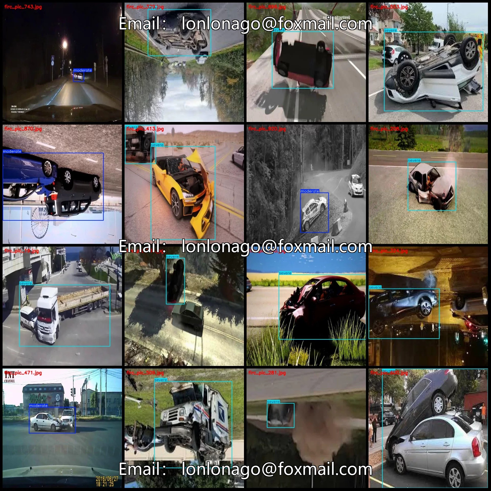
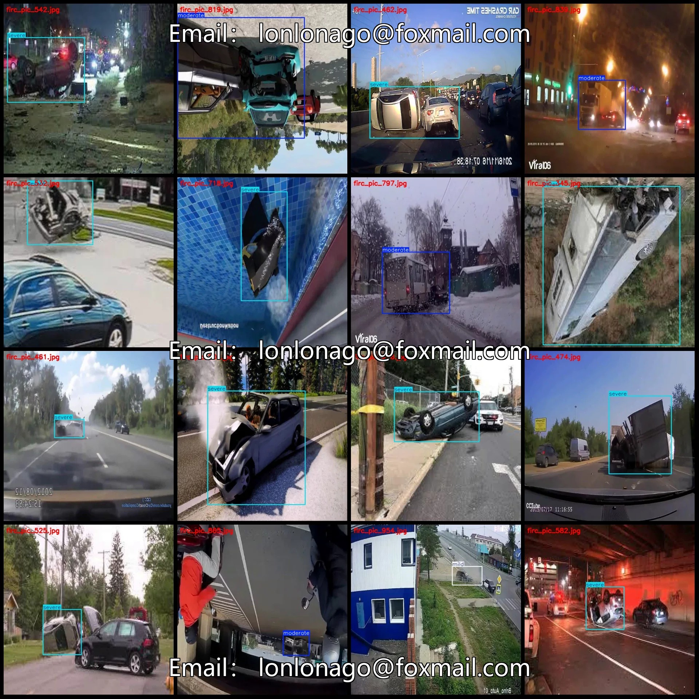
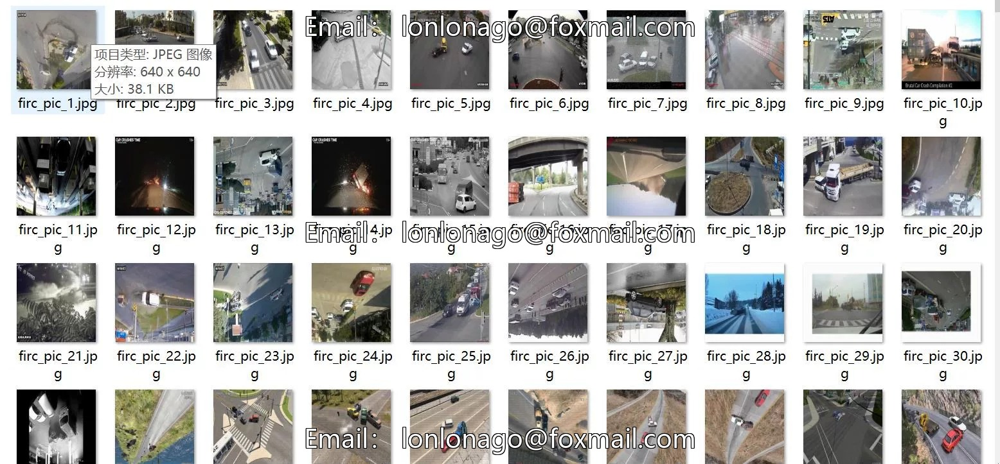
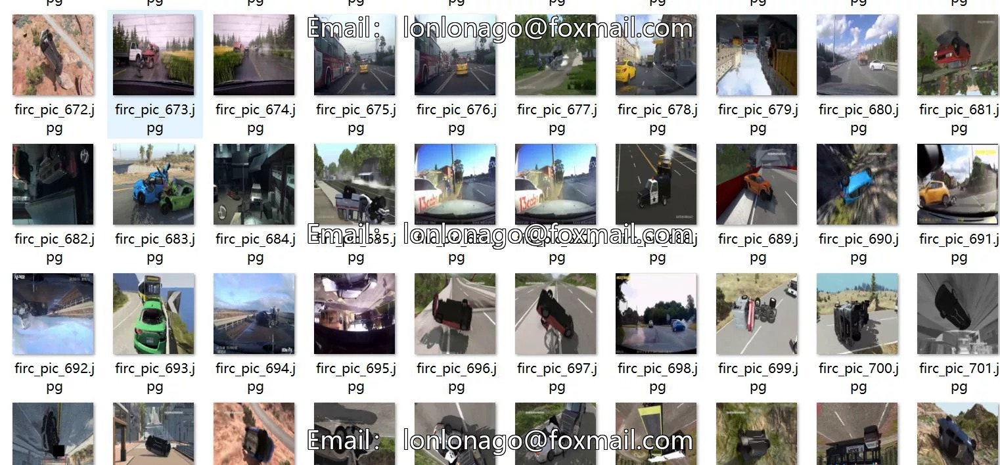
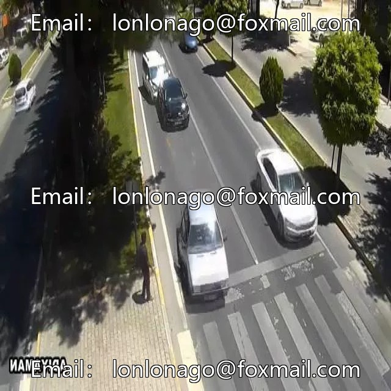
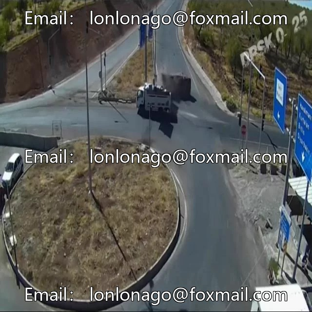

# Vehicle Traffic Accident Severity Detection Dataset VOC+YOLO format: 963 images.

## Body

Vehicle Traffic Accident Severity Detection Dataset - VOC+YOLO format, 963 images in 3 categories
Tips: Due to the dataset's replicability, please confirm compliance with requirements before purchasing.
Dataset format: Pascal VOC format + YOLO format (txt file without split path, only containing jpg images and corresponding VOC format xml files and yolo format txt files)
Number of images (number of jpg files): 963
Number of annotations (number of xml files): 963
Number of annotations (number of txt files): 963
Number of annotation categories: 3

Annotation category names (Note that the order of categories in YOLO format does not correspond to this, but is based on the labels folder's classes.txt): ["mild", "moderate", "severe"]
Number of boxes per category
Mild (mild) = 50
Moderate (moderate) = 261
Severe (severe) = 700
Total number of boxes: 1011
Number of images per category
Mild (mild) = 42
Moderate (moderate) = 259
Severe (severe) = 665
Image resolution: 640x640

Using labeling tool: labelImg
Labeling rules: Draw a rectangle around the category.
Important note: The dataset does not have separate training, validation, and test sets; you need to partition them yourself.
Special statement: This dataset does not guarantee the accuracy of the trained models or weight files.

## Images

## Payment

Here is a pay link on Stripe ( https://buy.stripe.com/3cs8yP7sY87d0vu9AB ). Please contact me lonlonago@foxmail.com after funding $89, and I will send you a complete data files , thank you!

